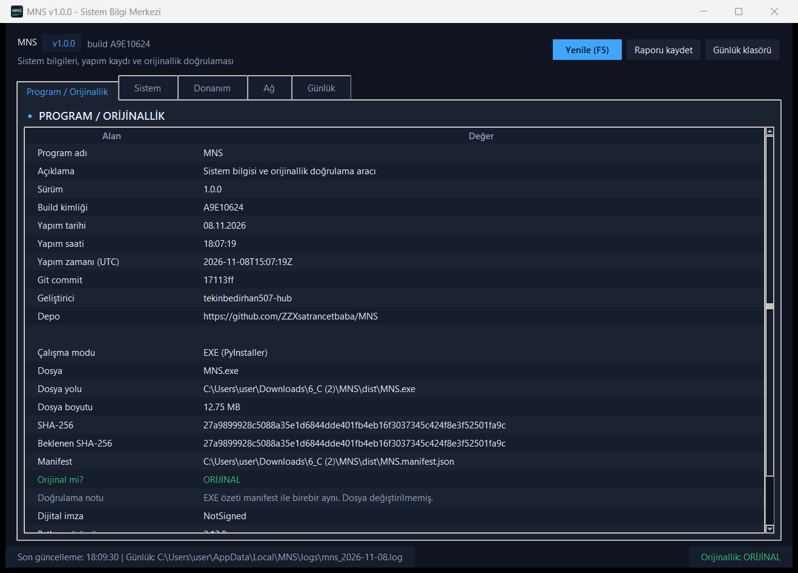

# MNS — Sistem Bilgi Merkezi

MNS, çalıştığı bilgisayarın **sistem / donanım / ağ** bilgilerini tek ekranda toplayan,
kendi **yapım kaydını** gösteren ve **orijinallik doğrulaması** yapan Windows masaüstü
uygulamasıdır.

- Dil: **Python 3.12**
- Arayüz: **Tkinter** (harici UI bağımlılığı yok)
- Paketleme: **PyInstaller 6 (--onefile --windowed)**
- Sürüm: **1.0.0**
- Yapım tarihi: aşağıdaki tabloda (çalıştırınca da görünür)

## Ekran görüntüsü



## Yapım bilgileri

| Alan | Değer |
| --- | --- |
| Program | MNS — Sistem Bilgi Merkezi |
| Sürüm | 1.0.0 |
| Geliştirici | tekinbedirhan507-hub |
| Python | 3.12.8 |
| PyInstaller | 6.22.3 (--onefile --windowed) |
| Yapım tarihi / saati | 08.11.2026 |
| EXE boyutu | ~12.7 MB |
| Dijital imza | Yok (NotSigned) |
| Doğrulama | SHA-256 + `MNS.manifest.json` |

## Özellikler

**Program / Orijinallik sekmesi**
- Program adı, sürüm, build kimliği, yapım tarihi ve saati (yerel + UTC)
- Git commit, geliştirici, depo adresi
- Çalışma modu (EXE / kaynak .py), dosya adı, tam yolu, boyutu
- Çalışan EXE'nin **SHA-256** özeti
- `MNS.manifest.json` içindeki beklenen özet ile karşılaştırma → **ORIJINAL / DEGISTIRILMIS / DOGRULANAMADI**
- Authenticode dijital imza durumu (bu sürüm imzasızdır: `NotSigned`)
- Kullanılan Python ve PyInstaller sürümleri

**Sistem sekmesi**
- Bilgisayar adı, kullanıcı, işletim sistemi adı/sürümü/derleme numarası, Windows edition, mimari
- Yerel/UTC saat, saat dilimi, sistem açılış zamanı, çalışma süresi (uptime)
- Python yolu, PID, sanal ortam (venv) durumu

**Donanım sekmesi**
- İşlemci modeli, fiziksel/mantıksal çekirdek sayısı, frekans
- RAM toplam / kullanılabilir / kullanım yüzdesi, sanal bellek
- Disk bölümleri ve doluluk oranları, çalışan işlem sayısı
- Ekran kartı, anakart, BIOS, bilgisayar modeli, ekran çözünürlüğü ve DPI

**Ağ sekmesi**
- Ana makine adı / FQDN, tüm arayüzler için IPv4, IPv6 ve MAC adresleri + bağlantı durumu
- Toplam gönderilen/alınan veri, varsayılan rotadaki yerel IP

**Günlük (log) sekmesi**
- Tüm işlemler günlüğe yazılır: `%LOCALAPPDATA%\MNS\logs\mns_YYYY-MM-DD.log`
- Uygulama içinden günlük görüntüleme ve klasörü açma

**Ekstra**
- `F5` yenile, `Ctrl+S` raporu kaydet, `Ctrl+C` tüm raporu panoya kopyala
- Satıra çift tıklayınca o satır panoya kopyalanır
- Koyu tema, sekmeli arayüz, durum çubuğunda orijinallik göstergesi
- Yüksek DPI ekranlarda bulanıklık olmaması için DPI farkındalığı (ölçekli arayüz)
- Komut satırı: `MNS.exe --rapor -o rapor.txt` (arayüz açmadan metin rapor)

## İndirme / Çalıştırma

Hazır EXE: [`dist/MNS.exe`](dist/MNS.exe) ve doğrulama dosyası
[`dist/MNS.manifest.json`](dist/MNS.manifest.json).

> EXE'yi çalıştırmak için Python kurulu olması gerekmez.
> Windows SmartScreen uyarısı çıkabilir çünkü dosya dijital olarak imzalanmamıştır
> ("Ek bilgi" → "Yine de çalıştır").

Orijinallik kontrolü için **MNS.exe ile MNS.manifest.json aynı klasörde** olmalıdır.
Manifest yoksa uygulama "DOGRULANAMADI" gösterir, yanlış özet varsa "DEGISTIRILMIS".

## Kaynaktan çalıştırma

```bash
python -m venv .venv
.venv\Scripts\activate
pip install -r requirements.txt
python app.py
```

Konsol raporu:

```bash
python app.py --rapor
python app.py --rapor -o rapor.txt
python app.py --surum
```

## Sıfırdan derleme (venv + PyInstaller)

```bash
python -m venv .venv
.venv\Scripts\activate
pip install -r requirements.txt

python tools\make_icon.py       # assets\mns.ico üretir
python build.py                 # build_info + version_info + PyInstaller + manifest
```

`build.py` şunları yapar:

1. `assets/mns.ico` yoksa Pillow ile yeniden üretir (16, 24, 32, 48, 64, 128, 256 px).
2. `tools/make_build_info.py` ile `build_info.py` dosyasını yazar
   (sürüm, yapım tarihi/saati, build kimliği, git commit).
3. `version_info.txt` üretir → EXE'nin sağ tık → Özellikler → Ayrıntılar bilgileri.
4. PyInstaller'ı `--onefile --windowed --icon assets/mns.ico` ile çalıştırır → `dist/MNS.exe`.
5. EXE'nin SHA-256 özetini ve kaynak dosya özetlerini `dist/MNS.manifest.json` içine yazar.

Sıfırdan temiz derleme: `python build.py --temiz`

## Dosya yapısı

```
MNS/
├─ app.py                  # Tkinter arayüzü + giriş noktası
├─ core.py                 # bilgi toplama, günlük, orijinallik doğrulama, rapor
├─ build_info.py           # üretilen yapım bilgileri (sürüm/tarih/build id)
├─ build.py                # tek komutla derleme betiği
├─ version_info.txt        # EXE sürüm kaynağı (build.py üretir)
├─ requirements.txt
├─ assets/
│  ├─ mns.ico              # uygulama + EXE ikonu (çok boyutlu)
│  └─ mns.png              # 1024 px logo
├─ tools/
│  ├─ make_icon.py         # ikon üretici (Pillow)
│  └─ make_build_info.py   # build_info.py üretici
├─ dist/
│  ├─ MNS.exe              # derlenmiş uygulama
│  └─ MNS.manifest.json    # orijinallik referansı (SHA-256)
├─ screenshots/
│  └─ mns-arayuz.png       # arayüz görüntüsü
└─ .gitignore
```

## Orijinallik doğrulama mantığı

1. Uygulama çalışırken kendi EXE dosyasını (paketliyse `sys.executable`) bayt bayt okur.
2. SHA-256 özeti hesaplanır.
3. EXE'nin yanındaki `MNS.manifest.json` okunur (`sha256`, `exe_size_bytes`, `source_sha256`).
4. Özetler eşitse **ORIJINAL**, farklıysa **DEGISTIRILMIS**, manifest yoksa **DOGRULANAMADI**.
5. Kaynak modda çalışırken `source_sha256` içindeki `app.py`, `core.py`, `build_info.py`
   özetleri karşılaştırılır.

Not: Dosyanın kendisi değiştirilmeden yalnızca manifest değiştirilirse sonuç yine tutarsız
olur; manifest'i de güncelleyen biri tarafından yeniden imzalanmadığı sürece bu kontrol
bütünlük (integrity) amaçlıdır, kriptografik imza yerine geçmez.

## Lisans

MIT — bkz. [LICENSE](LICENSE).
